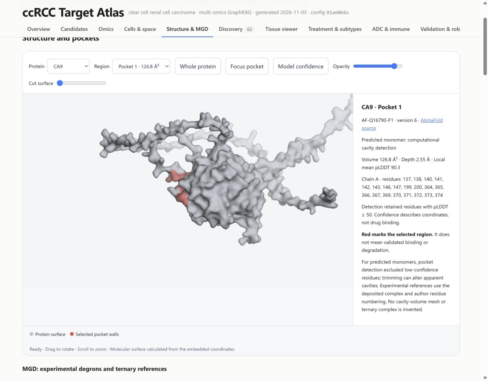
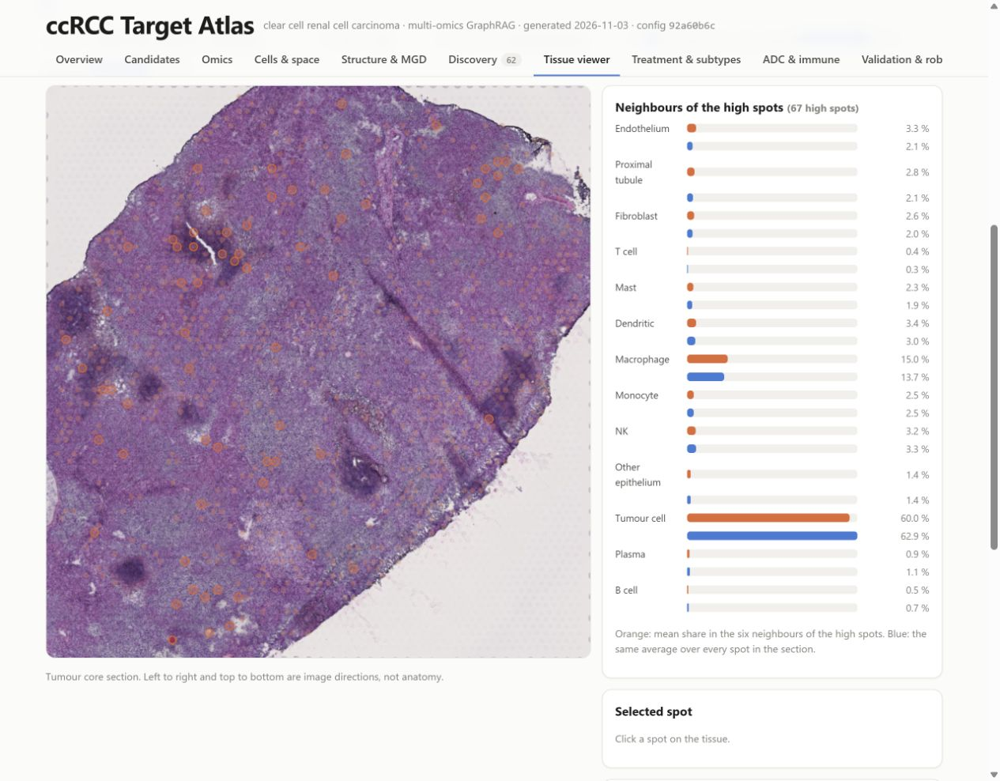

<div class="article-status"><span class="status-pill status-preview">Agentic AI · Computational oncology</span><span class="status-pill">Analysis snapshot · 3 November 2026</span></div>

::: {.vcc-intro}
I built this project around a practical question: when several datasets point to a gene in kidney cancer, what would make it worth following up? A large change in RNA is a starting point. It does not tell us whether the protein changes, which cells make it, whether normal tissues also need it, or what kind of treatment could reach it.

The atlas brings those questions together. Python computes the measurements, a knowledge graph keeps their provenance, and five specialist LLM agents retrieve and interpret the evidence. The result is a browser report where a reader can move from a shortlist to the measurements behind it. This page explains how it works, how to read every window, and where the conclusions stop.
:::

```{=html}
<div class="button-row atlas-actions">
<a class="button button-primary" href="https://rsolerortuno.github.io/agentic-kidney-atlas/">Explore the interactive atlas ↗</a>
<a class="button button-secondary" href="https://github.com/rsolerortuno/agentic-kidney-atlas">Read the code ↗</a>
</div>
<p class="atlas-note">No installation needed. The report is a large, self-contained HTML file, so the first load may take a moment. This case study documents the saved analysis above; the live atlas may receive later updates.</p>
<div class="vcc-stats" aria-label="Project scope">
<div><strong>19,161</strong><span>genes in the convergence ranking</span></div>
<div><strong>5</strong><span>specialist agents, plus an orchestrator</span></div>
<div><strong>13</strong><span>report tabs, from candidates to evidence</span></div>
<div><strong>1,000</strong><span>random re-weightings to assess rank stability</span></div>
</div>
```

## The question: what deserves another experiment?

The biological scope is **clear cell renal cell carcinoma (ccRCC)**, rather than every form of kidney cancer. The project combines tumour and matched normal tissue, additional patient cohorts, single cells, tissue sections, cell-line screens and published knowledge. These sources answer different questions and do not all measure the same patients.

A **target** is something a treatment might act on. A **biomarker** is something we measure to distinguish biological or clinical states. A gene can be useful for both, but the evidence needed is different. A gene that falls as a tumour loses normal kidney identity may make a useful biomarker without being something we should inhibit.

I therefore keep several rankings visible. The convergence score asks which genes have several supporting evidence streams. Separate target and biomarker profiles ask more specific questions. A discovery screen deliberately looks beyond well-studied genes, because a ranking that rewards existing papers will naturally favour familiar biology.

The intended output is **a set of hypotheses prioritised for experimental validation**, with supporting evidence and gaps. It is not a list of proven new treatments.

## From measurements to a readable argument

The workflow separates a measured result from a sentence about that result. This matters because a fluent explanation can remain wrong even when it contains a real citation.

```{=html}
<ol class="vcc-pipeline atlas-pipeline">
<li><span class="vcc-step">1</span><h4>Measure</h4><p>Python computes differential expression, replication, dependency and clinical associations.</p><em>Deterministic analysis</em></li>
<li><span class="vcc-step">2</span><h4>Record</h4><p>Results enter a graph with gene identity, source, metric and evidence identifiers.</p><em>SQLite + NetworkX</em></li>
<li><span class="vcc-step">3</span><h4>Investigate</h4><p>Specialist agents call tools, compare evidence and produce structured findings.</p><em>Claude + MCP tools</em></li>
<li><span class="vcc-step">4</span><h4>Check</h4><p>Code checks citations, numbers, direction and whether the cited data have changed.</p><em>Automatic verification</em></li>
<li><span class="vcc-step">5</span><h4>Inspect</h4><p>The report combines computed figures with checked narrative and links back to evidence.</p><em>Interactive HTML</em></li>
</ol>
```

The main discovery cohort is CPTAC ccRCC: 110 tumours, with matched normal samples available for subsets of the RNA, protein and phosphorylation measurements. TCGA-KIRC supplies RNA replication and survival information. A separate CPTAC proteomics cohort tests whether protein and phosphosite changes repeat. DepMap asks a different question: whether cancer cell lines lose fitness when a gene is disrupted.

Single-cell datasets help identify the cells making a gene. Spatial data place expression within a tissue section. Treatment cohorts test associations with progression and response. Literature and external databases add prior knowledge, molecular interactions, normal-tissue context and drug information. The [repository's source table](https://github.com/rsolerortuno/agentic-kidney-atlas#3-data-sources) gives the individual datasets and sizes.

### Why use a graph?

Here, a knowledge graph is a way to keep biological relationships attached to their evidence. A gene can be linked to an expression change, a cell type, a drug or a disease. Each relationship points to an evidence record. SQLite stores the records and NetworkX supports graph operations.

This is the GraphRAG part: the language model retrieves structured, connected evidence before writing. It does not have to reconstruct a gene's measurements from memory. The graph also makes it possible to ask whether two statements refer to the same gene and to trace a report claim back to its source. A graph edge still means only what its underlying evidence supports; it is not automatically causal.

## What the agents actually do

The agentic layer uses Claude Code as an orchestrator. It starts from a deterministic integration of the evidence, delegates bounded questions to five specialist agents, checks their structured findings, and assembles an interpretation. The names below describe their roles in English.

| Agent | Question it investigates | Evidence it contributes |
|---|---|---|
| **Multi-omics Agent** | Do the molecular measurements agree? | RNA, protein, copy number and other quantitative evidence. |
| **Cellular & Spatial Agent** | Which cells make the candidate, and where? | Single-cell attribution, tissue context, discovery-screen findings and descriptive structural context. |
| **Literature Agent** | What has already been reported? | Retrieved literature relations linked to their source text. |
| **External Knowledge Agent** | What do established resources say? | Drug, interaction, function and tractability context. |
| **Translational Analysis Agent** | Does the candidate make sense in a treatment setting? | Treatment associations, subtypes, antibody suitability, immune context and replication. |

The tools are exposed through four MCP servers: `omics-mcp`, `cell-mcp`, `kg-mcp` and `external-mcp`. MCP is the interface that lets an agent request a specific result from a defined tool. It is not another statistical model. The agent definitions, orchestration command and tool implementations are available in the [source repository](https://github.com/rsolerortuno/agentic-kidney-atlas).

The LLM helps choose what to investigate and makes a written judgement from retrieved evidence. The numerical ranking, statistical tests, plotted values and tables come from code. A separate literature-extraction step produces constrained relations and checks their quoted support against the source text.

### What the checker can establish

For a supported statement, the cited record must exist and belong to the relevant gene. A number must match a specific evidence field, including its direction and unit; finding the same number somewhere in a record is insufficient. A stale-text guard checks whether the evidence changed after the narrative was written. Unsupported findings are removed from the verified output.

For example, a sentence about a protein fold change should be checked against the protein fold-change field, not against an RNA value or a sample count that happens to match. This is an illustration of the checking rule, not a new biological finding.

The saved run reports 116 checked statements with no failures detected by those checks. **That does not establish that every scientific interpretation is correct.** A sentence may cite accurate numbers yet overstate causality, therapeutic feasibility or the independence of two datasets. Those judgements still need review. The [verification limits](https://github.com/rsolerortuno/agentic-kidney-atlas/blob/main/docs/numeric-claims.md) describe this boundary explicitly.

## A guided tour of all thirteen windows

Open the atlas alongside this page. Each heading below links directly to the corresponding report tab. The round **?** buttons inside the report explain individual plots and tables. Start with Overview, then follow one gene through Candidates, Cells & space, Validation & robustness and Methods & evidence before reading a longer shortlist.

### 01 · [Overview](https://rsolerortuno.github.io/agentic-kidney-atlas/#tab=overview)

**Question:** what does this run conclude, and where should I start?

This is the summary and navigation window. Read the project scope and the interpretation, then use its guided-tour cards to open the detailed analyses. The headline counters describe the available analysis, not a count of validated treatments. Read the limitations alongside the candidate summary: they determine how much weight the shortlist can carry.

### 02 · [Candidates](https://rsolerortuno.github.io/agentic-kidney-atlas/#tab=candidates)

**Question:** why is a particular gene on the shortlist?

This window combines the prioritised candidates with the convergence ranking and its component evidence. Inspect the evidence card for a gene before comparing its total score with another gene. A high aggregate can be driven by different combinations of measurements, prior literature and tractability.

The cards distinguish support, non-favourable evidence and missing measurements, and describe a possible intervention route. An antibody, an enzyme inhibitor and a degrader require different evidence. A suggested modality is a research rationale, not proof that a drug with that mechanism will work. A blank replication result means it was not measured adequately; it is different from a measured change in the opposite direction.

### 03 · [Omics](https://rsolerortuno.github.io/agentic-kidney-atlas/#tab=omics)

**Question:** what changes between tumour and healthy kidney?

Compare RNA and protein differential-expression plots, then inspect the grade associations and the multi-omics findings. On a volcano plot, the horizontal axis describes the size and direction of the change; the vertical axis describes statistical evidence. A log2 fold change of +1 means twice the level, while −1 means half. A small adjusted p-value does not by itself imply a large or therapeutically useful effect.

RNA and protein need not agree. Their disagreement is informative: transcription, translation, protein turnover and tissue composition all affect the measurements. Paired tests use matched patient samples where available, and multiple-testing correction accounts for the many genes examined.

### 04 · [Cells & space](https://rsolerortuno.github.io/agentic-kidney-atlas/#tab=cells)

**Question:** is the bulk signal made by tumour cells or by their neighbours?

Use the cell-type summaries to identify the likely source of a candidate, then check the second single-cell dataset and spatial neighbourhood results. A strong bulk increase can come from infiltrating immune cells or stroma rather than the malignant compartment. That may change the therapeutic question rather than make the gene uninteresting.

Read expression share and detection frequency separately. A large share of a gene's transcripts coming from tumour cells does not mean that every tumour cell expresses it. The cell datasets also come from different patients from the bulk discovery cohort, and dissociation can distort the recovered cell mixture.

### 05 · [Structure & MGD](https://rsolerortuno.github.io/agentic-kidney-atlas/#tab=structure)

**Question:** what structural context can we inspect, and what is actually known about degradation?

The 3D viewer draws a soft grey molecular surface. Red marks the selected pocket-wall residues or reference region. Choose a **Protein**, choose a **Region**, drag to rotate and scroll to zoom. **Whole protein** restores the overall view; **Focus pocket** centres the selected region. **Opacity** exposes internal context and **Cut surface** lets you look through the surface. **Model confidence** shows AlphaFold confidence for predicted monomers; it is not an experimental confidence score for deposited complexes.

The highlighted surface comes from structure coordinates. It is not a simulated cloud of atoms, a measured binding affinity or proof that a compound can fit there. Pocket detection excluded low-confidence residues, and trimming can change the apparent cavities. Check the source and residue identifiers in the side panel.

{fig-alt="Screenshot of the CA9 protein viewer with grey molecular surface, red selected residues and structure controls."}

**MGD means molecular glue degrader.** A glue can promote an interaction between a target protein and an E3 ubiquitin ligase, enabling degradation. A degron is a recognition feature; a ternary complex contains the participating target, ligase machinery and compound. Geometry in a single predicted protein does not establish that whole mechanism.

The atlas therefore separates descriptive pocket features from curated experimental degron and ternary-complex references. Experimental complexes illustrate known systems with their original proteins, ligases and compounds. They are not predicted complexes for the candidate genes. The useful outcome here is a better structural question for follow-up, not a claim that the atlas has designed a glue degrader.

### 06 · [Discovery](https://rsolerortuno.github.io/agentic-kidney-atlas/#tab=discovery)

**Question:** which less-studied candidates deserve a closer look?

The convergence ranking rewards existing evidence. This screen instead highlights genes with tumour-related expression, a defined cellular source, relatively little ccRCC literature and no clinical drug under its rules. Compare the tumour, stromal and immune tracks separately, since they represent different intervention settings.

COL23A1 and RAB42 appear as exploratory tumour-cell candidates. Read the supporting RNA and cell-source evidence, then the missing normal-tissue protein, dependency and confirmatory-proteomics evidence. In particular, generic membrane annotation does not establish extracellular accessibility for an antibody.

“Novel” in this screen is an operational filter—at most 15 ccRCC papers and no clinical drug—not a claim that nobody has studied the gene. Earlier preclinical work can already exist. The defensible statement is that the analysis prioritises hypotheses for validation.

### 07 · [Tissue viewer](https://rsolerortuno.github.io/agentic-kidney-atlas/#tab=viewer)

**Question:** what sits next to the spots expressing a gene?

Select a tissue section and gene. Four sections have their own stained H&E images in this viewer. Colour spots by expression or estimated cell composition, and adjust opacity to compare the overlay with tissue morphology. Orange rings identify the highest tenth of expressing spots. Click a spot to inspect it and its six neighbours.

The orange bars summarise the cell composition around high-expression spots; the blue bars show the section average. A longer orange bar suggests local enrichment. These live bars are descriptive. The separate permutation-test results across all 23 sections are the inferential evidence. Visium spots contain mixtures of cells, so a neighbourhood pattern does not prove a direct interaction between two individual cells.

{fig-alt="Screenshot of the tissue viewer showing stained tumour tissue, ringed expression spots and cell-composition comparison bars."}

### 08 · [Treatment & subtypes](https://rsolerortuno.github.io/agentic-kidney-atlas/#tab=response)

**Question:** does the candidate behave differently across treatment arms or tumour subgroups?

First inspect the treatment controls, then the per-arm associations and between-arm comparison. An association with progression within one arm is not enough to show that a biomarker selects one treatment over another. That requires evidence that the relationship differs between treatments. In this run, no gene separates the main immunotherapy and sunitinib arms after multiple-testing correction.

The subtype part compares mutation-defined groups, including VHL, PBRM1, BAP1 and SETD2, and the ccA/ccB expression classification. A subgroup difference can refine a hypothesis, but small groups, correlated features and infiltration can also influence it. Survival association does not establish that changing a gene will change survival.

### 09 · [ADC & immune](https://rsolerortuno.github.io/agentic-kidney-atlas/#tab=adcimmune)

**Question:** could a candidate be a delivery address, or an immune target?

The antibody-drug conjugate and radioligand analysis asks about surface accessibility, tumour increase, expression across tumour cells and staining in vital normal tissues. An ADC delivers a payload through an antibody; a radioligand delivers radiation. Neither requires that the surface protein itself be a selective genetic dependency, but both need more than high RNA expression.

Compare candidate positions with known-target controls, then inspect the normal-tissue evidence. No signal in the available data is not proof of safety. The immune profile asks a separate question about immune-cell biology and hot or cold tumours. Its controls perform unevenly: only one of seven checkpoint controls reaches the top 100. Treat that profile as exploratory rather than a validated ordering of immune targets.

### 10 · [Validation & robustness](https://rsolerortuno.github.io/agentic-kidney-atlas/#tab=validation)

**Question:** does the evidence survive another cohort or another reasonable scoring choice?

Start with confirmatory proteomics. Directional replication supports a molecular observation; it does not validate a treatment. Missing measurements should remain separate from contradictory ones. CA9 and CD70 are too sparse in normal kidney in the label-free confirmatory data to support the same paired test, while HK2 is an example that does not replicate there.

Next compare target and biomarker profiles and the rank intervals under random weights. The interval describes sensitivity to the scoring choices, not a confidence interval for treatment success. Finally inspect clinical-target benchmarks, baselines and repeated agent runs. These evaluate different properties and should not be collapsed into one “accuracy” number. The charts below explain two of those checks.

### 11 · [Literature & drugs](https://rsolerortuno.github.io/agentic-kidney-atlas/#tab=literature)

**Question:** what is established already, and what is only a database association?

Inspect the extracted literature relations and external-knowledge tables. Follow the evidence behind an apparently strong claim: a paper may report expression, a perturbation experiment or a clinical association, and these are different levels of support. Source-text validation checks that the reported text is present; it does not establish the quality or generalisability of the study.

Drug annotations are useful context, but a multi-target drug does not show that every listed protein drives its efficacy. The literature corpus is also a retrieved subset, not an exhaustive systematic review. A low paper count is a prompt to investigate, not proof of novelty.

### 12 · [Network](https://rsolerortuno.github.io/agentic-kidney-atlas/#tab=network)

**Question:** how do the leading genes connect to drugs, disease and one another?

Use the network to navigate relationships among top candidates. Click an edge to inspect its relation type and evidence identifier. The graph is a compact map of the stored evidence, not a complete model of the tumour. Node proximity comes from the layout; it does not represent physical distance, an effect size or a causal relationship.

### 13 · [Methods & evidence](https://rsolerortuno.github.io/agentic-kidney-atlas/#tab=methods)

**Question:** can I audit the argument?

This is the place to inspect provenance, limitations, remaining gaps and the evidence records cited in the report. Follow an evidence identifier from a candidate or narrative statement and check the gene, source, metric and context. This is the most important final step before reusing a result in a proposal or experiment.

The saved report validator resolves 449 claims and 1,646 cited evidence records, with no external resources needed by the report itself. Those counts describe traceability checks on this snapshot. They do not mean that 449 claims have been independently validated in the laboratory.

## Two checks that change how I read the shortlist

### A strong global benchmark can hide weak early retrieval

The target profile has an AUROC of 0.895 against 75 clinical RCC targets. AUROC measures how well a score tends to order positive examples above background across all thresholds. It is not the fraction of candidates that will become successful drugs.

Predicted tractability alone reaches 0.857, close to the full profile: clinical targets are already enriched for proteins that drugs can reach. But it puts none of the 75 clinical targets in its top 100, whereas the target profile retrieves 17%. Looking at both metrics makes the contribution of the other data more concrete.

```{=html}
<figure class="atlas-figure"><div class="atlas-chart-scroll"><svg viewBox="0 0 760 225" role="img" aria-label="Clinical-target benchmark: AUROC" xmlns="http://www.w3.org/2000/svg"><title>Clinical-target benchmark: AUROC</title><g font-family="Arial,sans-serif" fill="#292722">
<path d="M255.0 25V165" stroke="#ded8ce"/><text x="255.0" y="190" font-size="13" text-anchor="middle">0</text>
<path d="M360.0 25V165" stroke="#ded8ce"/><text x="360.0" y="190" font-size="13" text-anchor="middle">0.25</text>
<path d="M465.0 25V165" stroke="#ded8ce"/><text x="465.0" y="190" font-size="13" text-anchor="middle">0.5</text>
<path d="M570.0 25V165" stroke="#ded8ce"/><text x="570.0" y="190" font-size="13" text-anchor="middle">0.75</text>
<path d="M675.0 25V165" stroke="#ded8ce"/><text x="675.0" y="190" font-size="13" text-anchor="middle">1</text>
<text x="242" y="63" font-size="15" text-anchor="end">Target profile</text><rect x="255" y="45" width="375.90000000000003" height="28" rx="3" fill="#c96545"/><text x="640.9000000000001" y="65" font-size="15">0.895</text>
<text x="242" y="123" font-size="15" text-anchor="end">Tractability alone</text><rect x="255" y="105" width="359.94" height="28" rx="3" fill="#687f73"/><text x="624.94" y="125" font-size="15">0.857</text>
</g></svg></div><figcaption>AUROC against 75 clinical RCC targets: 0.895 for the target profile and 0.857 for predicted tractability alone. Axis spans 0 to 1; chance ordering corresponds to 0.5. Source: saved evaluation, 3 November 2026.</figcaption></figure><figure class="atlas-figure"><div class="atlas-chart-scroll"><svg viewBox="0 0 760 225" role="img" aria-label="Clinical targets retrieved in the top 100" xmlns="http://www.w3.org/2000/svg"><title>Clinical targets retrieved in the top 100</title><g font-family="Arial,sans-serif" fill="#292722">
<path d="M255.0 25V165" stroke="#ded8ce"/><text x="255.0" y="190" font-size="13" text-anchor="middle">0%</text>
<path d="M360.0 25V165" stroke="#ded8ce"/><text x="360.0" y="190" font-size="13" text-anchor="middle">25%</text>
<path d="M465.0 25V165" stroke="#ded8ce"/><text x="465.0" y="190" font-size="13" text-anchor="middle">50%</text>
<path d="M570.0 25V165" stroke="#ded8ce"/><text x="570.0" y="190" font-size="13" text-anchor="middle">75%</text>
<path d="M675.0 25V165" stroke="#ded8ce"/><text x="675.0" y="190" font-size="13" text-anchor="middle">100%</text>
<text x="242" y="63" font-size="15" text-anchor="end">Target profile</text><rect x="255" y="45" width="71.4" height="28" rx="3" fill="#c96545"/><text x="336.4" y="65" font-size="15">17%</text>
<text x="242" y="123" font-size="15" text-anchor="end">Tractability alone</text><rect x="255" y="105" width="0.0" height="28" rx="3" fill="#687f73"/><text x="265.0" y="125" font-size="15">0%</text>
</g></svg></div><figcaption>Recall among the same 75 clinical targets at a shortlist size of 100 genes. Rounded values from the evaluation. High global AUROC does not guarantee useful early retrieval.</figcaption></figure>
```

These are retrospective comparisons with a selected clinical-target reference set. The post-2016 subset is particularly small: six genes, including PARP1, PARP2 and PARP3 from one drug class. Features were not frozen before 2016. It cannot establish prospective prediction of future targets.

### A high rank should survive reasonable changes in weights

The convergence score depends on the importance assigned to each evidence stream. The project repeats the ranking under 1,000 random weight choices, rather than reporting one ordering as inevitable. CA9 and COXFA4L2 (formerly NDUFA4L2) are the only genes in this run that remain in the top ten in at least 80% of those draws.

```{=html}
<figure class="atlas-figure"><div class="atlas-chart-scroll"><svg viewBox="0 0 760 225" role="img" aria-label="Frequency in the top ten across 1000 random weight draws" xmlns="http://www.w3.org/2000/svg"><title>Frequency in the top ten across 1000 random weight draws</title><g font-family="Arial,sans-serif" fill="#292722">
<path d="M255.0 25V165" stroke="#ded8ce"/><text x="255.0" y="190" font-size="13" text-anchor="middle">0%</text>
<path d="M360.0 25V165" stroke="#ded8ce"/><text x="360.0" y="190" font-size="13" text-anchor="middle">25%</text>
<path d="M465.0 25V165" stroke="#ded8ce"/><text x="465.0" y="190" font-size="13" text-anchor="middle">50%</text>
<path d="M570.0 25V165" stroke="#ded8ce"/><text x="570.0" y="190" font-size="13" text-anchor="middle">75%</text>
<path d="M675.0 25V165" stroke="#ded8ce"/><text x="675.0" y="190" font-size="13" text-anchor="middle">100%</text>
<text x="242" y="63" font-size="15" text-anchor="end">CA9</text><rect x="255" y="45" width="373.8" height="28" rx="3" fill="#c96545"/><text x="638.8" y="65" font-size="15">89%</text>
<text x="242" y="123" font-size="15" text-anchor="end">COXFA4L2 / NDUFA4L2</text><rect x="255" y="105" width="369.6" height="28" rx="3" fill="#687f73"/><text x="634.6" y="125" font-size="15">88%</text>
</g></svg></div><figcaption>Top-ten frequency under 1,000 random re-weightings: CA9 89%, COXFA4L2 88%. These are weight-sensitivity results, not probabilities of therapeutic success. Source: saved README summary, 3 November 2026.</figcaption></figure>
```

These frequencies are rounded from the saved summary. They describe the sampled weight settings, not every possible weighting. No gene stays in the top ten in all draws. The alias matters too: the 3 November correction mapped TCGA's NDUFA4L2 label to COXFA4L2 and recovered its RNA replication. An identifier mismatch can change a biological conclusion without any underlying measurement changing.

## What would I follow up biologically?

The atlas recovers familiar ccRCC biology, including strong hypoxia-related signals, and puts several candidates in a form that is easier to investigate. The useful next decision is what evidence to collect, rather than which gene to declare a discovery.

| Example | What makes it worth inspecting | What I would need before a stronger claim |
|---|---|---|
| **CA9** | Strong convergent signal and relatively stable ranking; a useful known-biology reference. | Modality-specific accessibility and safety evidence; its confirmatory paired-protein result is missing, not negative. |
| **NNMT** | Consistent molecular evidence supports a metabolic hypothesis. | Perturbation and pharmacology in appropriate models, plus normal-tissue context; expression alone does not establish selective dependency. |
| **COL23A1** | Exploratory expression and tumour-cell attribution make it worth examining beyond the familiar shortlist. | Accessible protein and normal-tissue staining, coverage across tumour cells and functional experiments; prior work must be checked before any novelty claim. |
| **RAB42** | A second exploratory tumour-cell hypothesis from the discovery track. | Mechanistic and protein-level evidence; membrane association alone does not justify an antibody strategy. |
| **PSAT1 / PCK1** | Loss of kidney-associated expression can be informative as a biomarker. | Independent biomarker evaluation for a defined use; downregulation does not imply that further inhibition would help. |

These are examples of how to use the atlas, not a new therapeutic ranking. A selective dependency, a surface delivery address and a prognostic marker are different hypotheses. A negative dependency screen does not rule out every possible modality, and a positive expression screen does not establish any of them.

## What this demonstrates about agentic AI

The engineering contribution is a workflow in which agents investigate a shared body of evidence and leave inspectable outputs. The system combines tool calling, task decomposition, structured findings, evidence retrieval, deterministic scoring, claim checks and reproducible reporting.

The strongest demonstrated benefit is **traceable synthesis**: it is possible to inspect why a candidate was discussed, which source supports a sentence and where evidence is missing. The project does not establish that adding agents discovers better therapies than the deterministic pipeline alone. Much of the agreement across agent runs comes from their shared numerical ranking.

The memory-only baseline tends to return familiar textbook targets without the pipeline's evidence trail. That comparison illustrates grounding, but it is not a matched clinical validation of agent reasoning. To measure the agents' added value more rigorously, I would need a fixed set of scientific review tasks, blinded assessment and a comparison with the same retrieved evidence presented without agent synthesis.

The most useful design decision was keeping failure modes visible. A changing identifier, an unsupported sentence, a weak immune-control result or an unmeasurable confirmatory protein should affect the interpretation. The pipeline should not turn those gaps into a confident paragraph.

## Reproduction and the remaining limits

The deterministic rebuild uses retained local inputs with recorded hashes, a locked environment and saved model outputs. It refuses drift from the frozen input snapshot and rebuilds offline. This reproduces the analysis from the retained evidence; it does not guarantee that a fresh download from an evolving provider will yield the same bytes, or that a new LLM run will produce identical prose.

The [reproduction guide](https://github.com/rsolerortuno/agentic-kidney-atlas/blob/main/docs/reproduction.md) explains the required local data snapshot and commands. Cloning the code alone does not supply all downloaded datasets. The report itself can be explored immediately without that setup.

The main scientific limitations remain the cohort sizes and composition, the imperfect correspondence between bulk, single-cell and spatial samples, cell-line conditions that differ from tumours, weak treatment-interaction evidence, and the absence of experimental validation of the proposed candidates. The structural layer is descriptive. Automatic checking reduces specific errors in narrative reporting; it does not replace scientific judgement.

## Source record and further reading

This case study uses the saved `runs/2026-11-03` analysis and the repository state at [`2300306`](https://github.com/rsolerortuno/agentic-kidney-atlas/tree/2300306ffa5ee0f5b40102ee0d6fabdf30a5cf18). The charts reproduce values in the saved evaluation and README; no new experiments or model runs were performed for this page.

- [Interactive report](https://rsolerortuno.github.io/agentic-kidney-atlas/) — the figures, controls, candidate cards and evidence records.
- [Evaluation results at the documented snapshot](https://github.com/rsolerortuno/agentic-kidney-atlas/blob/2300306ffa5ee0f5b40102ee0d6fabdf30a5cf18/evals/results.md) — benchmarks and baseline comparisons.
- [README at the documented snapshot](https://github.com/rsolerortuno/agentic-kidney-atlas/blob/2300306ffa5ee0f5b40102ee0d6fabdf30a5cf18/README.md) — datasets, methods and saved results.
- [Agent definitions](https://github.com/rsolerortuno/agentic-kidney-atlas/tree/2300306ffa5ee0f5b40102ee0d6fabdf30a5cf18/.claude/agents) and [orchestration command](https://github.com/rsolerortuno/agentic-kidney-atlas/blob/2300306ffa5ee0f5b40102ee0d6fabdf30a5cf18/.claude/commands/informe.md) — the implemented roles and workflow.
- [Verification limits](https://github.com/rsolerortuno/agentic-kidney-atlas/blob/2300306ffa5ee0f5b40102ee0d6fabdf30a5cf18/docs/numeric-claims.md) and [reproduction guide](https://github.com/rsolerortuno/agentic-kidney-atlas/blob/2300306ffa5ee0f5b40102ee0d6fabdf30a5cf18/docs/reproduction.md) — what can be checked and rebuilt.

<div class="button-row atlas-actions"><a class="button button-primary" href="https://rsolerortuno.github.io/agentic-kidney-atlas/">Open the atlas and follow one candidate ↗</a><a class="button button-secondary" href="../projects.html">Back to all projects</a></div>
